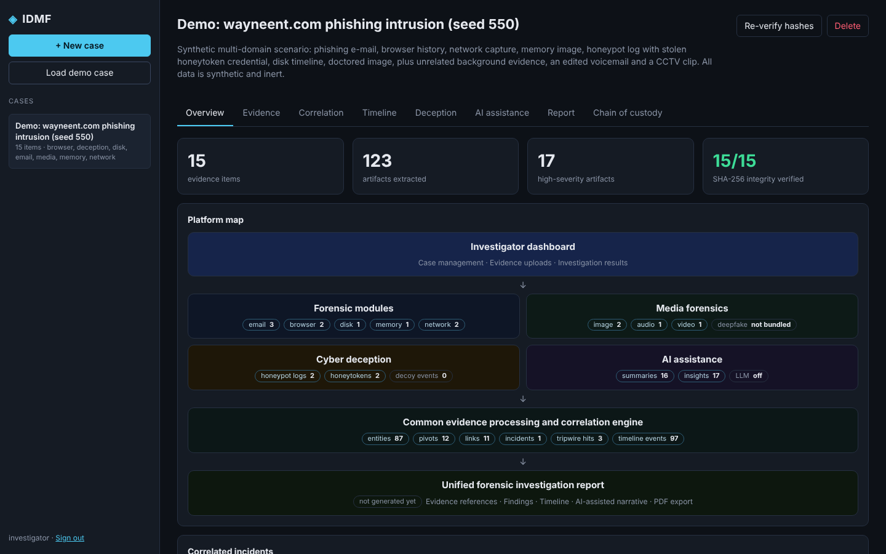
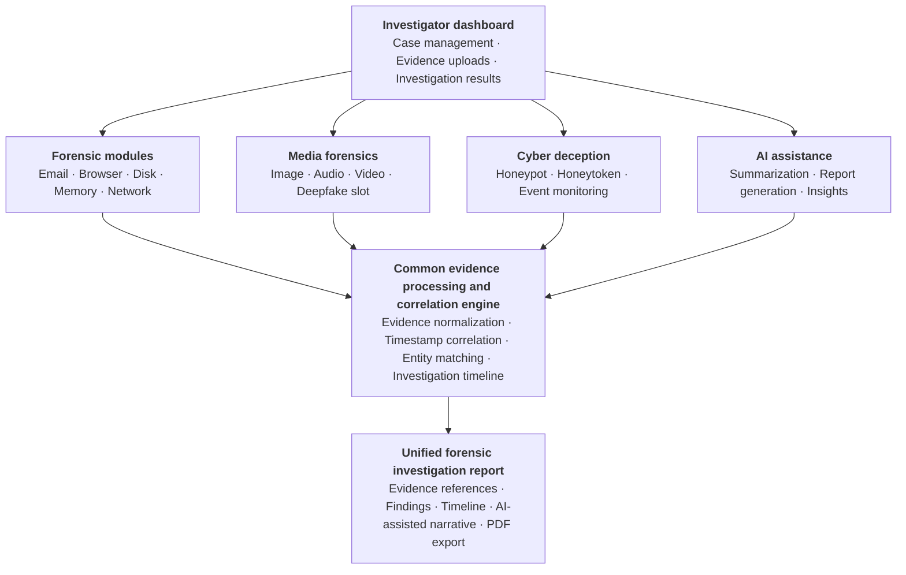
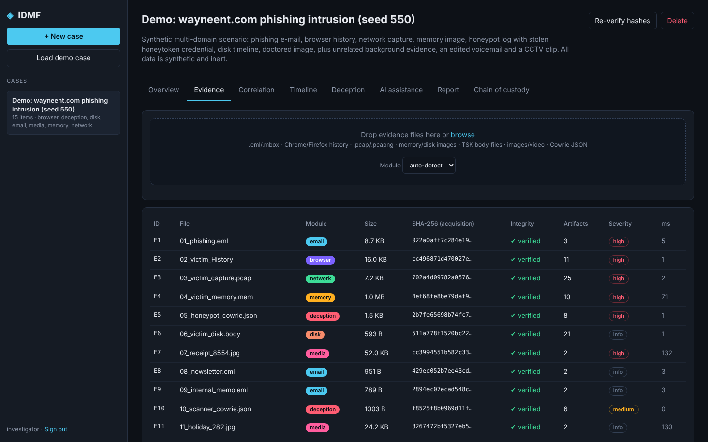
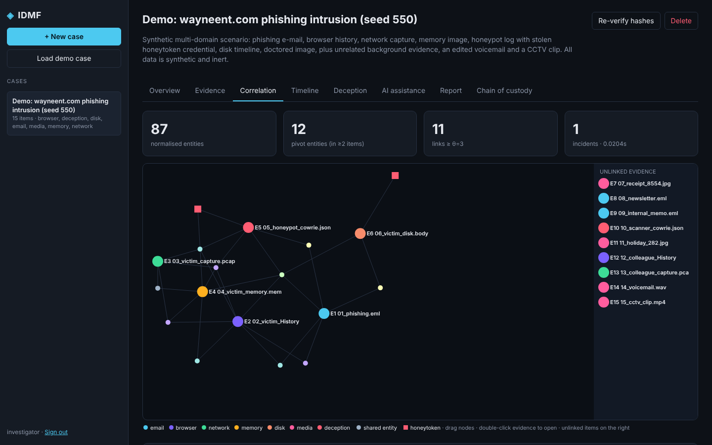
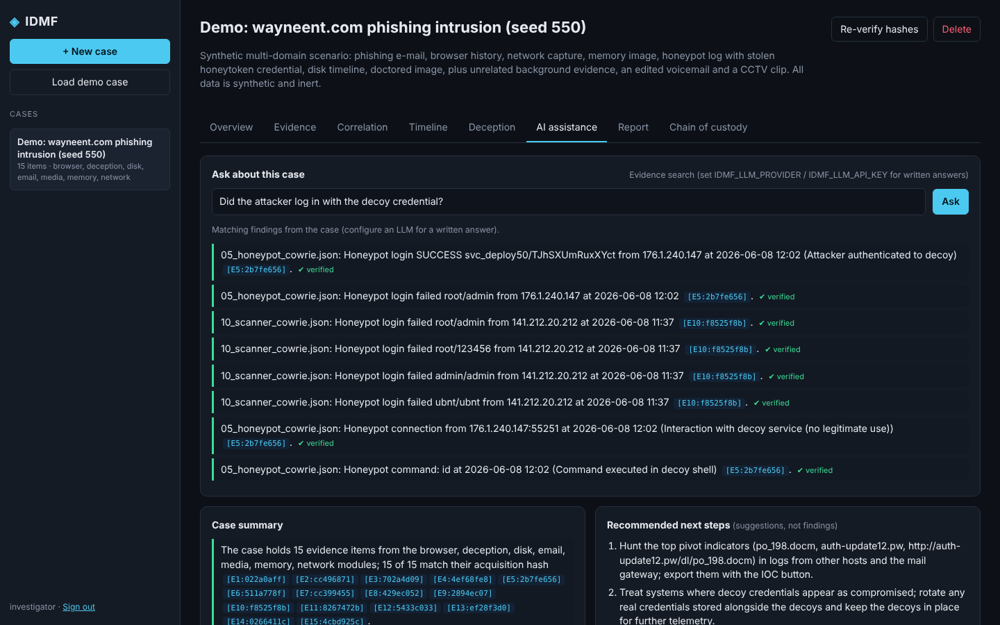
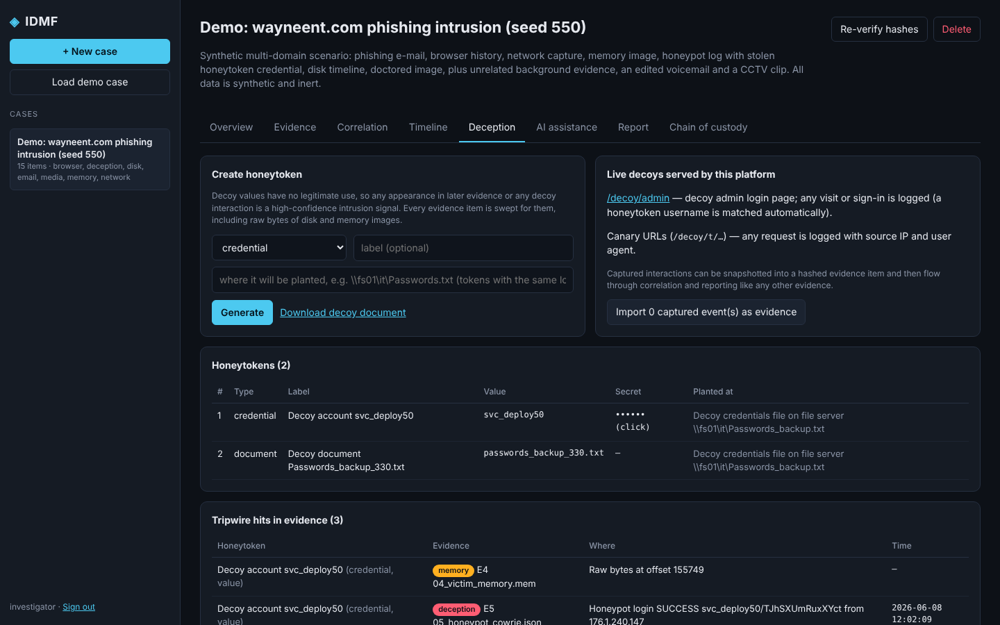
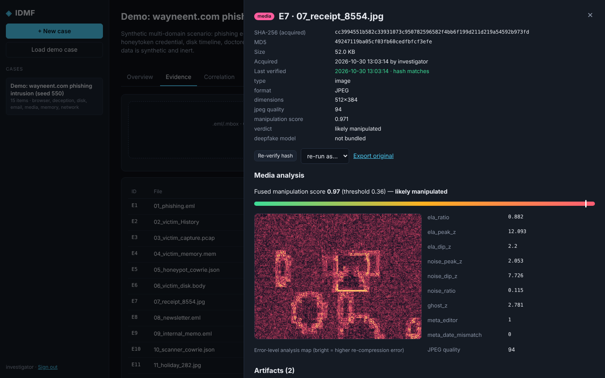
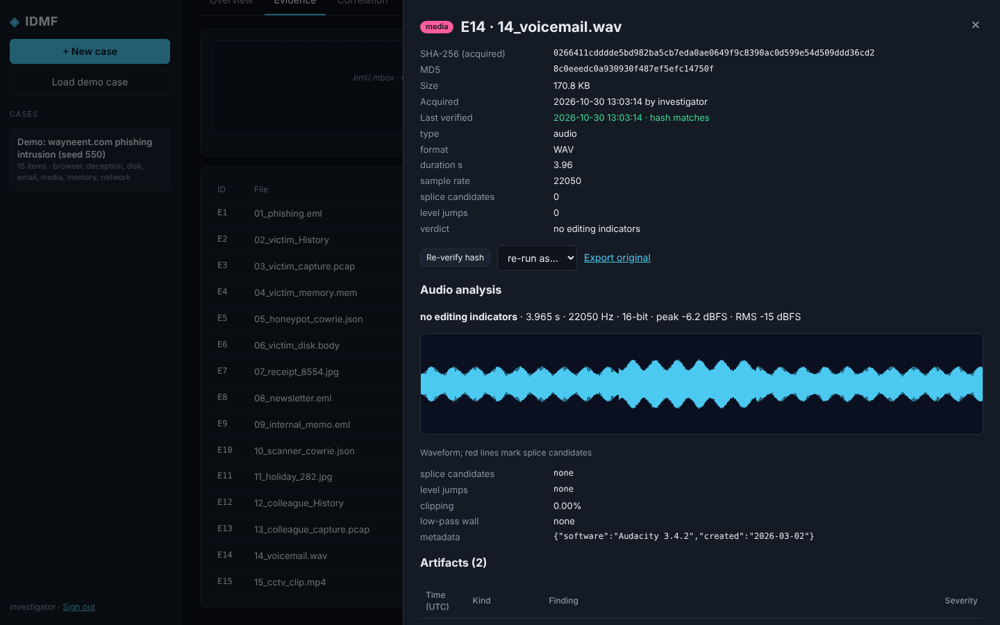
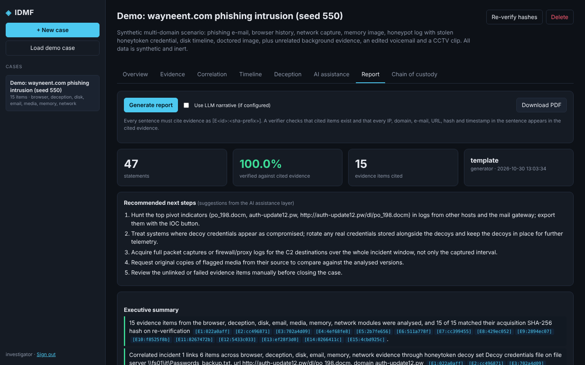
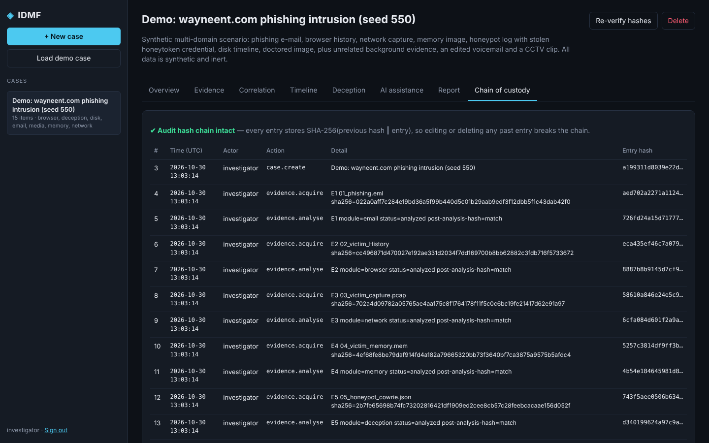

# IDMF — Intelligent Deception & Media Forensics Platform

[](https://github.com/<your-username>/idmf-platform/actions/workflows/tests.yml)


A unified digital-investigation platform that brings **forensic modules** (email, browser, disk, memory, network), **media forensics** (image, audio, video), **cyber deception** (honeypots, honeytokens, live decoys) and **AI assistance** (summaries, insights, report generation) together on **one evidence store, one cross-domain correlation engine and one evidence-grounded investigation report**.



> Research prototype accompanying the paper *"IDMF: An Intelligent Cyber Deception and Media Forensics Platform with Cross-Domain Evidence Correlation and Evidence-Grounded Reporting"*. All demo and benchmark data is synthetic and inert.

---

## Contents
- [Architecture](#architecture)
- [Features](#features)
- [Repository structure](#repository-structure)
- [Quick start](#quick-start)
- [Supported evidence](#supported-evidence)
- [How it works](#how-it-works)
- [API](#api)
- [Configuration](#configuration)
- [Evaluation](#evaluation)
- [Screenshots](#screenshots)
- [Limitations and roadmap](#limitations-and-roadmap)
- [Research background](#research-background)
- [License](#license)

---

## Architecture



Each layer of the diagram is a package in `backend/app/`:

| Layer | Package | What is inside |
| --- | --- | --- |
| Investigator dashboard | `frontend/`, `backend/app/main.py` | Single-page web client and REST API |
| Forensic modules | `backend/app/forensics/` | `email_forensics`, `browser_forensics`, `disk_forensics`, `memory_forensics`, `network_forensics`, shared `carving` engine |
| Media forensics | `backend/app/media/` | `image_forensics`, `audio_forensics`, `video_forensics`, `deepfake` slot, fitted `media_model.json` |
| Cyber deception | `backend/app/deception/` | `honeytokens`, `decoys` (live decoy portal, canary URLs, event monitoring), `honeypot` (Cowrie logs) |
| AI assistance | `backend/app/ai/` | `summarizer`, `insights` (MITRE ATT&CK mapping, pivots, IOC export), `assistant` (grounded Q&A), `llm` (optional) |
| Correlation engine | `backend/app/core/` | `entities` (normalisation), `integrity` (hashing, vault), `pipeline` (routing), `correlation` (entity matching, timestamp correlation, incidents, timeline) |
| Unified report | `backend/app/reporting/` | `narrative`, `verifier`, `report`, `pdf` |

## Features

**Evidence handling**
- SHA-256 + MD5 at acquisition, write-once read-only evidence vault, hash re-verified after every analysis and on demand
- Hash-chained chain-of-custody log: every entry commits to the previous one, so any edit is detected at the exact entry
- Login with PBKDF2-SHA256 password hashes and signed tokens; cases, evidence, honeytokens and decoy events in SQLite (PostgreSQL supported)

**Forensic modules**
- **Email** (`.eml`, `.mbox`): Received path and sender IP, SPF/DKIM/DMARC, Reply-To and Return-Path mismatch, display-name spoofing, link-text mismatch, attachment hashes and risky types
- **Browser** (Chrome/Edge `History`, Firefox `places.sqlite`, CSV/JSON exports): visits, downloads, raw-IP and look-alike URLs (databases are copied and opened read-only)
- **Network** (`.pcap`, `.pcapng`, dependency-free parser): flows, DNS, HTTP, TLS SNI; DNS tunnelling, beaconing, uncommon ports, cleartext credentials
- **Disk**: Sleuth Kit / Autopsy body files → file-system timeline (deleted files, executables in user-writable paths); raw images → carving
- **Memory**: string carving (ASCII + UTF-16) for IOCs, processes, file names, suspicious-command signatures; optional Volatility 3 `windows.pslist`

**Media forensics**
- **Image**: EXIF/metadata checks, JPEG quality, error-level analysis with heat-map, JPEG ghosts, noise-residual inconsistency, all fused by a calibrated logistic model
- **Audio** (WAV natively, other formats via ffprobe): splice candidates (waveform discontinuities), abrupt level jumps, clipping, lossy-codec low-pass detection, RIFF metadata (editing software), waveform image
- **Video**: ffprobe metadata or container sniffing; with OpenCV, duplicated/frozen-frame runs, abrupt cuts and per-frame image traces
- **Deepfake**: reported as *not bundled*; the slot keeps the gap visible in reports

**Cyber deception**
- Honeytoken generator: decoy credentials, cloud API keys, canary URLs, honey e-mail addresses, decoy document names, grouped into decoy sets
- Live decoys served by the platform (`/decoy/admin`, `/decoy/t/<token>`) with event monitoring; captured events become hashed evidence
- Cowrie honeypot log ingestion (connections, logins, commands, captured downloads)
- Tripwire sweep: every evidence item, including raw disk/memory bytes, is searched for every honeytoken

**AI assistance**
- Evidence and case summaries, every sentence cited and verified
- Insights: MITRE ATT&CK tactic/technique mapping of the attack chain, pivot indicators, honeypot attackers seen elsewhere, flagged media, unlinked high-severity evidence, integrity failures
- Recommended next steps (clearly marked as suggestions) and IOC export as CSV
- "Ask about this case": evidence search by default; with an LLM configured, written answers that are verified sentence by sentence

**Correlation engine and report**
- Typed entity normalisation (IP, domain, URL, e-mail, hash, file, user, process), IDF- and type-weighted entity matching with a temporal boost, allowlist and popularity prior, own-organisation dampening, honeytoken tripwires
- Explained links (shared entities, weights, time gap), incidents, evidence graph and a unified UTC timeline
- One consolidated report with evidence inventory, ATT&CK attack chain, findings, correlation, deception and media sections, timeline and custody log; every sentence cites evidence and is verified; PDF export

## Repository structure

```
idmf-platform/
├── backend/app/
│   ├── main.py                 # FastAPI app: REST API + dashboard
│   ├── config.py · auth.py · db.py
│   ├── core/                   # Common evidence processing & correlation engine
│   │   ├── entities.py         #   normalisation and entity extraction
│   │   ├── integrity.py        #   hashing, write-once vault
│   │   ├── pipeline.py         #   file-type routing, module execution
│   │   └── correlation.py      #   entity matching, timestamp correlation, incidents, timeline
│   ├── forensics/              # Forensic modules
│   │   ├── email_forensics.py · browser_forensics.py · network_forensics.py
│   │   ├── disk_forensics.py · memory_forensics.py · carving.py
│   ├── media/                  # Media forensics
│   │   ├── image_forensics.py · audio_forensics.py · video_forensics.py · deepfake.py
│   │   └── media_model.json    #   fitted fusion model
│   ├── deception/              # Cyber deception
│   │   ├── honeytokens.py · decoys.py · honeypot.py
│   ├── ai/                     # AI assistance
│   │   ├── summarizer.py · insights.py · assistant.py · llm.py
│   ├── reporting/              # Unified forensic investigation report
│   │   ├── narrative.py · verifier.py · report.py · pdf.py
│   └── demo/                   # synthetic labelled scenarios (demo case + benchmark)
│       ├── scenario.py · media_samples.py
├── frontend/                   # index.html · app.js · style.css (no build step)
├── experiments/                # run_experiments.py + results/results.json
├── tests/                      # end-to-end tests (pytest)
├── sample_data/                # a labelled scenario to upload by hand
├── docs/screenshots/
├── .github/workflows/tests.yml # CI
├── requirements.txt · run.bat · run.sh · LICENSE
```

## Quick start

Requires **Python 3.10+**.

**Windows** — double-click `run.bat` (creates a virtual environment on first run, installs requirements and opens the browser).

**Linux / macOS**
```bash
./run.sh
```

**Manual**
```bash
git clone https://github.com/<your-username>/idmf-platform.git
cd idmf-platform
python -m venv .venv
.venv\Scripts\activate            # Windows  (Linux/macOS: source .venv/bin/activate)
pip install -r requirements.txt
python -m uvicorn backend.app.main:app --port 8000
```

Open **http://127.0.0.1:8000** and sign in with **`investigator` / `forensics123`** (change it or register a new account). Click **Load demo case** to create a fully analysed case from a synthetic intrusion, or create a case and drop the files in `sample_data/scenario_seed42/` onto the Evidence tab. Interactive API docs are at **http://127.0.0.1:8000/docs**.

**Demo walkthrough:** Overview (platform map) → Evidence (open any item) → Correlation (graph and explained links) → Timeline → Deception (honeytokens, tripwire hits, live decoys) → AI assistance (summary, ATT&CK chain, pivots, ask a question) → Report (generate, download PDF) → Chain of custody.

## Supported evidence

| Module | Input | Main output |
| --- | --- | --- |
| Email | `.eml`, `.mbox` | messages, sender path, auth results, phishing indicators, attachments |
| Browser | Chrome/Edge `History`, Firefox `places.sqlite`, `*history*.csv/json` | visits, downloads, suspicious URLs |
| Network | `.pcap`, `.pcapng` | flows, DNS, HTTP, TLS SNI, tunnelling, beaconing |
| Disk | Sleuth Kit body file (`fls -m`), raw images | file-system timeline, carved IOCs |
| Memory | `.mem`, `.vmem`, `.dmp`, `.lime`, `*mem*.raw` | IOCs, processes, command signatures, Volatility pslist |
| Media | `.jpg/.png/.tif/.webp`, `.wav` (+ mp3/m4a/flac via ffprobe), `.mp4/.mov/.avi/.mkv` | manipulation score and traces, splice candidates, frame anomalies |
| Deception | Cowrie JSON logs, IDMF decoy-event exports | sessions, logins, commands, captured downloads |

Files are routed by signature and extension; the module can be overridden at upload or re-run from the evidence panel.

## How it works

**Correlation.** Every module emits artifacts with normalised entities. For N evidence items and an entity e found in df(e) of them, the engine scores each pair of items A, B:

```
w(e)    = λ_type(e) · log((N + 1) / df(e)) · η(e)          η = 0.2 for the investigated organisation's own identifiers
S(A, B) = Σ_{e ∈ A ∩ B} w(e) · (1 + β · [Δt_e ≤ τ])        link when S ≥ θ   (θ = 3, τ = 15 min, β = 0.5)
```

Type weights λ: hashes 3.0, URLs 2.5, IPs and e-mails 2.0, domains and users 1.5, file names 1.0, processes 0.5. Allowlisted infrastructure, popular sites and generic honeypot user names are dropped first; IPs the evidence resolves from allowlisted domains inherit the allowlist. Items that contain honeytokens from the same decoy set are always linked. Incidents are connected components of the link graph.

**Report verification.** Every sentence cites evidence as `[E<id>:<sha-prefix>]`. A sentence is *verified* only when its citations exist and every IP, domain, e-mail, URL, hash and timestamp in it occurs in the cited evidence. The same check applies to AI-generated text. It verifies provenance of identifiers, not the meaning of a claim.

**Optional LLM.**
```bash
set IDMF_LLM_PROVIDER=anthropic      # or: openai  (any OpenAI-compatible endpoint via IDMF_LLM_BASE_URL)
set IDMF_LLM_API_KEY=...
set IDMF_LLM_MODEL=...               # optional
```
The LLM only rewrites facts produced locally (report narrative, assistant answers); unverified sentences are flagged.

## API

| Method | Endpoint | Purpose |
| --- | --- | --- |
| POST | `/api/auth/login`, `/api/auth/register` | get a bearer token |
| GET/POST | `/api/cases` | list / create cases |
| POST | `/api/cases/{id}/evidence` | upload evidence (multipart, optional `module`) |
| GET | `/api/evidence/{id}` | artifacts and summary of one item |
| POST | `/api/evidence/{id}/verify`, `/api/cases/{id}/verify` | re-verify hashes |
| GET | `/api/cases/{id}/correlation` | links, incidents, graph, timeline, tripwire hits |
| GET | `/api/cases/{id}/ai/insights` | summaries, ATT&CK chain, pivots, insights, recommendations |
| POST | `/api/cases/{id}/ai/ask` | grounded question answering |
| GET | `/api/cases/{id}/iocs.csv` | IOC export |
| GET/POST | `/api/cases/{id}/honeytokens` | list / generate honeytokens |
| GET | `/api/cases/{id}/deception-events` | captured decoy interactions |
| POST | `/api/cases/{id}/report` · GET `/api/cases/{id}/report.pdf` | generate / export the report |
| GET | `/api/cases/{id}/audit` | chain-of-custody log and chain status |
| POST | `/api/demo` | create the synthetic demo case |

Full schema at `/docs`.

## Configuration

| Variable | Default | Meaning |
| --- | --- | --- |
| `IDMF_DATA_DIR` | `./data` | evidence vault, database, derived files |
| `DATABASE_URL` | SQLite in the data dir | e.g. `postgresql+psycopg2://user:pw@host/idmf` |
| `IDMF_CORR_THRESHOLD` | `3.0` | link threshold θ |
| `IDMF_CORR_WINDOW_MIN` | `15` | temporal window τ in minutes |
| `IDMF_PUBLIC_URL` | `http://127.0.0.1:8000` | base URL written into canary-URL honeytokens |
| `IDMF_MAX_UPLOAD_MB` | `512` | upload limit |
| `IDMF_LLM_PROVIDER` / `IDMF_LLM_API_KEY` / `IDMF_LLM_MODEL` / `IDMF_LLM_BASE_URL` | unset | optional LLM |

## Evaluation

```bash
python -m experiments.run_experiments           # about 2 minutes; writes experiments/results/results.json
python -m experiments.run_experiments --quick   # smoke test
python -m pytest -q                             # end-to-end tests
```

The benchmark generates 40 labelled cases (520 evidence items, 4,550 artifacts: a multi-stage intrusion plus background evidence that shares common identifiers) and 400 labelled images. Thresholds and the media model are fitted on a calibration half and reported on the held-out half.

| Experiment | Result (held-out synthetic data) |
| --- | --- |
| Evidence integrity | 520/520 hashes unchanged after analysis; 520/520 single-bit flips and 50/50 audit-log edits detected |
| Entity extraction | precision 0.997, recall 0.998 across six modules |
| Cross-domain correlation | **F1 0.983** (precision 1.000, recall 0.967) vs 0.454 naive shared-entity linking and 0.692 IDF-only |
| Deception linkage | honeypot log joined the incident in 18/20 cases with tripwires vs 17/20 without |
| Report verification | 688/688 sentences traceable; 100% of injected wrong IPs, domains, times, missing citations and fake evidence IDs flagged; 0% of semantic flips |
| Media (images) | fusion **F1 0.920, AUC 0.975**; best single trace (noise residual) F1 0.839 |
| Performance | correlation of 208 items in 0.13 s; carving 13–16 MB/s (pure Python) |

These numbers show the pipeline works as designed on synthetic data; they are not field accuracy. See [Limitations](#limitations-and-roadmap).

## Screenshots

| | |
| --- | --- |
|  |  |
| Evidence intake with hashes and integrity | Cross-domain correlation graph and explained links |
|  |  |
| AI assistance: grounded Q&A, summaries, ATT&CK chain | Honeytokens, tripwire hits and live decoys |
|  |  |
| Image forensics with ELA heat-map | Audio forensics with splice markers |
|  |  |
| Verified, evidence-cited report | Hash-chained chain of custody |

## Limitations and roadmap

- Benchmarks are synthetic; validate on public corpora (CASIA v2 / FaceForensics++ for media, CIC-IDS2017 / UNSW-NB15 pcaps, NIST CFReDS images) before drawing conclusions.
- The popularity prior is a short built-in list; production use should load a full top-sites ranking such as Tranco.
- The verifier checks identifiers and times, not meaning; a flipped verdict passes.
- No bundled deepfake classifier; disk analysis relies on body files and carving rather than full file-system parsing; audio splice detection is a heuristic.
- Single-node prototype: evidence is analysed synchronously on upload; no role-based access control beyond authentication.

Roadmap: real-corpus evaluation, entailment-based claim checking, learned link weights and an evidence knowledge graph, Autopsy/Volatility API integration, background job queue, host-level decoys.

**Responsible use.** Run decoys and honeypots only on infrastructure you own or are authorised to monitor, and handle real evidence under your organisation's legal and privacy rules.

## Research background

The design responds to gaps identified in:
1. F. Casino et al., "Research Trends, Challenges, and Emerging Topics in Digital Forensics: A Review of Reviews," *IEEE Access*, 2022. doi:10.1109/ACCESS.2022.3154059
2. S. Rizvi et al., "Application of Artificial Intelligence to Network Forensics: Survey, Challenges and Future Directions," *IEEE Access*, 2022. doi:10.1109/ACCESS.2022.3214506
3. P. Beltrán-López et al., "Cyber Deception: Taxonomy, State of the Art, Frameworks, Trends, and Open Challenges," *IEEE Communications Surveys & Tutorials*, 2026. doi:10.1109/COMST.2025.3594788
4. L. Verdoliva, "Media Forensics and DeepFakes: An Overview," *IEEE JSTSP*, 2020. doi:10.1109/JSTSP.2020.3002101
5. J. P. Khatiwala et al., "Evaluating the Reliability of Digital Forensic Evidence Discovered by Large Language Model: A Case Study," *IEEE COMPSAC*, 2025. doi:10.1109/COMPSAC65507.2025.00138
6. H. Zhou et al., "Forensic Intelligence Graphs: An LLM Approach to Digital Evidence Extraction and Relationship Analysis," *IEEE COMPSAC*, 2025. doi:10.1109/COMPSAC65507.2025.00278

If you use this work, please cite:
```bibtex
@misc{idmf2026,
  title  = {IDMF: An Intelligent Cyber Deception and Media Forensics Platform with Cross-Domain Evidence Correlation and Evidence-Grounded Reporting},
  author = {[Your Name]},
  year   = {2026},
  url    = {https://github.com/<your-username>/idmf-platform}
}
```

## License

MIT — see [LICENSE](LICENSE).
